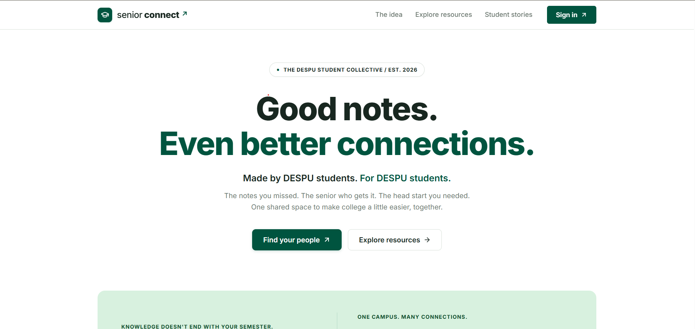
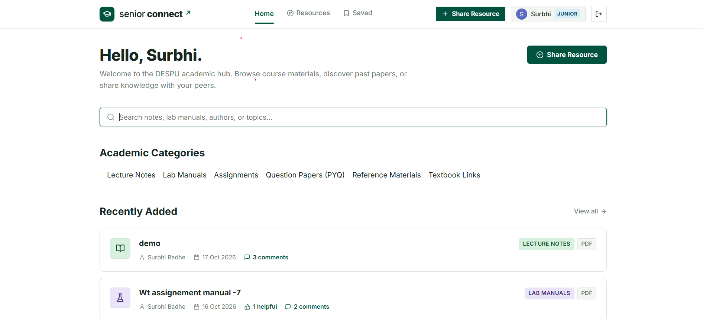
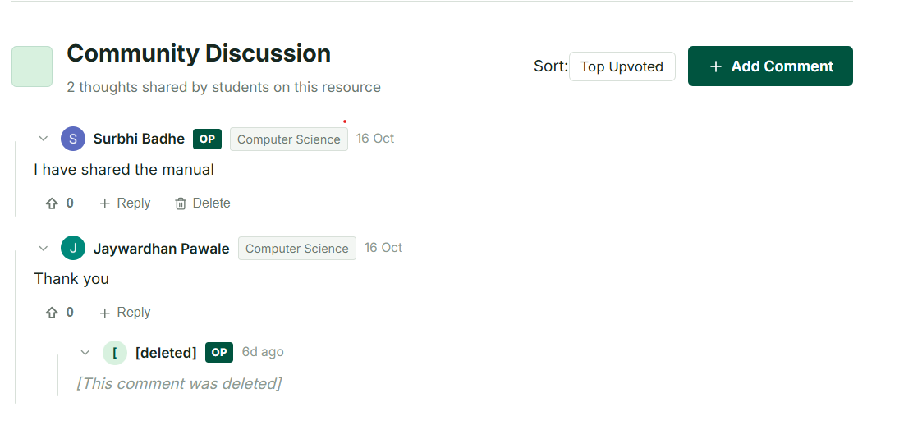
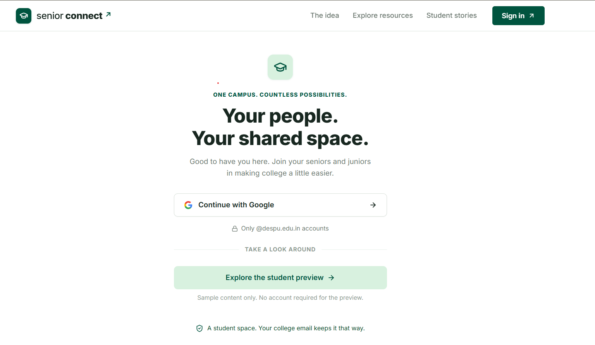

# SeniorConnect

**A full-stack academic resource-sharing platform connecting college juniors and seniors.**

SeniorConnect enables students to share, discover, and discuss academic resources, including lecture notes, lab manuals, assignments, previous question papers, and reference materials.

**Live Application:** [seniorconnect-edu.vercel.app](https://seniorconnect-edu.vercel.app/)

**Repository:** [github.com/surbhibadhe/Senior-connect](https://github.com/surbhibadhe/Senior-connect)

---

## Screenshots


### Landing Page
<!-- Add a screenshot of the landing page -->


### Resource Browsing
<!-- Add a screenshot of the resource listing and category filters -->


### Resource Details and Discussions
<!-- Add a screenshot of a resource detail page and its comments -->


### Authentication
<!-- Add a screenshot of the sign-in page -->


---

## Features

- **Google OAuth 2.0 Authentication:** Sign in using verified college accounts restricted to the `@despu.edu.in` domain.
- **Role-Based Access Control:** Supports Junior, Senior, and Admin roles.
- **Academic Resource Management:** Create and access resources through REST APIs, including text content, documents, and external links.
- **Category-Based Filtering:** Browse academic materials by category.
- **Search and Pagination:** Find relevant resources efficiently.
- **Bookmarks and Helpfulness Feedback:** Save resources and indicate whether they are useful.
- **Discussion Threads:** Comment on resources, reply to discussions, and upvote comments.
- **Student Reviews:** Display student reviews on the landing page and allow authenticated students to submit reviews.
- **Resource Reporting and Moderation:** Support reporting and administrative review of resources.
- **CSRF Protection:** Protect state-changing requests against cross-site request forgery.
- **Persistent Data Storage:** Store user, resource, review, bookmark, and discussion data in PostgreSQL.

## Technology Stack

| Layer | Technologies |
|---|---|
| Frontend | React 18, TypeScript, Vite |
| Routing | React Router 6 |
| UI Icons | Lucide React |
| Backend | Java 25, Spring Boot 4.x |
| Security | Spring Security 7, Google OAuth 2.0 |
| Persistence | Spring Data JPA, Hibernate |
| Database | PostgreSQL |
| API | REST APIs, JSON, CSRF protection |
| Build Tools | Maven, npm, Vite |
| Deployment | Vercel, Render, Neon PostgreSQL, Docker |

## Resource Categories

- Notes
- Lab Manuals
- Assignments
- Question Papers (PYQs)
- Reference Materials
- Textbook Links

## Architecture

SeniorConnect follows a layered backend architecture, separating HTTP request handling, business logic, database access, and persistent entities.

```text
React + TypeScript Frontend
          |
          | HTTP / REST API
          v
Spring Security
          |
          v
     Controllers
          |
          v
       Services
          |
          v
      Repositories
          |
          v
   Spring Data JPA
          |
          v
      PostgreSQL
```

The frontend communicates with the Spring Boot backend through REST APIs. Spring Data JPA and Hibernate handle database persistence, while Spring Security manages authentication and request security.

## Project Structure

```text
Senior-connect/
├── frontend/
│   └── src/
│       ├── components/
│       ├── hooks/
│       ├── pages/
│       └── App.tsx
├── src/
│   ├── main/
│   │   ├── java/com/project/seniorconnect/
│   │   │   ├── Config/
│   │   │   ├── Controller/
│   │   │   ├── DTO/
│   │   │   ├── Entity/
│   │   │   ├── Exception/
│   │   │   ├── Repository/
│   │   │   └── Service/
│   │   └── resources/
│   └── test/
├── screenshots/
├── Dockerfile
├── pom.xml
└── README.md
```

## Getting Started

### Prerequisites

- Java 25 or a compatible configured JDK
- Node.js 18 or later and npm
- Maven, or the included Maven Wrapper
- PostgreSQL
- Google OAuth 2.0 credentials

### 1. Clone the repository

```bash
git clone https://github.com/surbhibadhe/Senior-connect.git
cd Senior-connect
```

### 2. Configure PostgreSQL

Create a PostgreSQL database named `seniorconnect_db`.

Configure the database connection using environment variables:

```text
SPRING_DATASOURCE_URL
SPRING_DATASOURCE_USERNAME
SPRING_DATASOURCE_PASSWORD
```

### 3. Configure Google OAuth

Create an OAuth 2.0 client in Google Cloud Console and configure the client ID and client secret.

Set the following environment variables:

```text
GOOGLE_CLIENT_ID
GOOGLE_CLIENT_SECRET
```

Configure the authorized redirect URI to match the backend environment. For the deployed backend, the callback is:

```text
https://senior-connect-he4r.onrender.com/login/oauth2/code/google
```

Never commit client secrets, database passwords, or other credentials to GitHub.

### 4. Run the backend

On macOS or Linux:

```bash
./mvnw spring-boot:run
```

On Windows:

```powershell
.\mvnw.cmd spring-boot:run
```

### 5. Run the frontend

Open a separate terminal:

```bash
cd frontend
npm install
npm run dev
```

Open the local frontend at:

```text
http://localhost:5173
```

Ensure the backend CORS configuration, frontend API base URL, OAuth redirect settings, and session-cookie settings are configured for the environment in which the application is running.

## API Endpoints

The following endpoints document the application's resource, review, and discussion APIs. Authentication requirements are summarized below; the exact behavior is determined by the backend security configuration.

### Resources

| Method | Endpoint | Description |
|---|---|---|
| GET | `/api/resources` | Retrieve resources with pagination |
| GET | `/api/resources/{id}` | Retrieve a resource by ID |
| POST | `/api/resources` | Create a resource |
| GET | `/api/resources/{id}/comments` | Retrieve resource comments |
| POST | `/api/resources/{id}/comments` | Add a comment or reply |
| POST | `/api/resources/{id}/comments/{cid}/upvote` | Upvote a comment |
| DELETE | `/api/resources/{id}/comments/{cid}` | Delete a comment |

### Reviews

| Method | Endpoint | Description |
|---|---|---|
| GET | `/api/reviews` | Retrieve student reviews |
| POST | `/api/reviews` | Submit a student review |
| DELETE | `/api/reviews/{id}` | Delete a review, subject to authorization |

### Security

| Method | Endpoint | Description |
|---|---|---|
| GET | `/api/csrf` | Retrieve a CSRF token |

State-changing requests such as `POST`, `PUT`, `PATCH`, and `DELETE` must comply with the application's authentication, authorization, and CSRF requirements. Requests protected by CSRF validation must provide the expected token in the `X-XSRF-TOKEN` header.

## Deployment

- **Frontend:** [Vercel](https://vercel.com/)
- **Backend:** [Render](https://render.com/)
- **Database:** [Neon PostgreSQL](https://neon.tech/)

Live application: [https://seniorconnect-edu.vercel.app/](https://seniorconnect-edu.vercel.app/)

## Author

**Surbhi Badhe**

- GitHub: [@surbhibadhe](https://github.com/surbhibadhe)


---

*SeniorConnect — Sharing knowledge, connecting seniors and juniors.*
